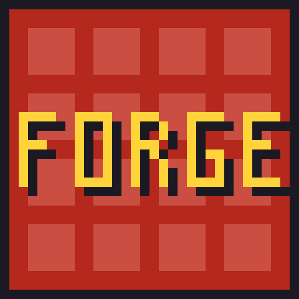
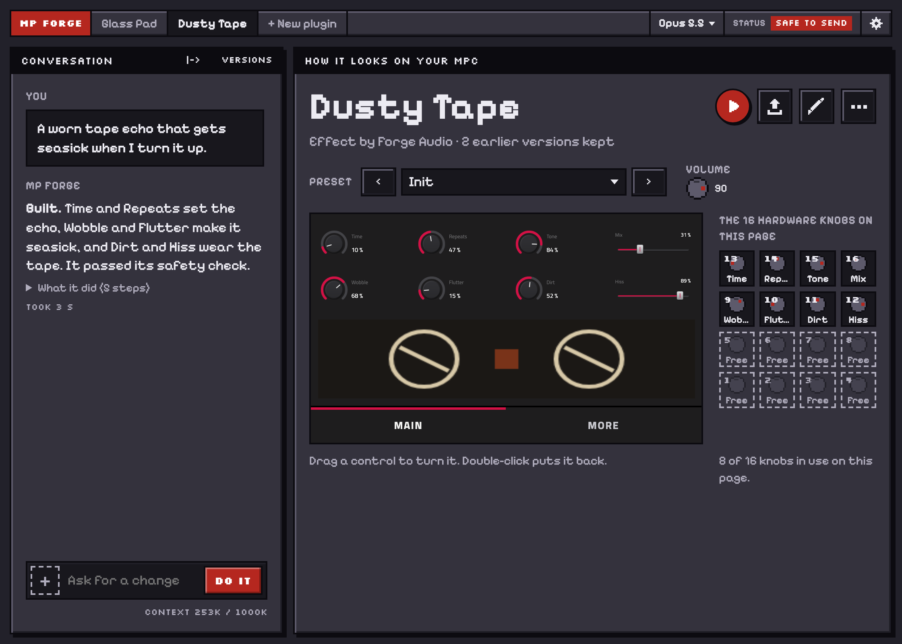

<p align="center">
  
</p>

<h1 align="center">MP Forge</h1>

<p align="center">
  <b>Describe a plugin. Hear it. Send it to your MPC.</b><br>
  A free, open-source app that makes plugins for Akai MPC hardware from a description.
</p>

<div align="center">

[![GET STARTED][get-started-button]][get-started]

[**Get started**][get-started] · [Download][download] · [What you need][what-you-need] · [The safety checks][safety-checks] · [Where it stands][status]


</div>

## What it is

MP Forge is a desktop app for musicians who do not program. You describe an instrument or an effect in plain
words, in a chat. An AI of your choice builds it with Akai's own MPC Plugin SDK. MP Forge checks that the
plugin is safe, shows you its MPC screen, lets you play it on your computer, and sends it to your MPC.

<p align="center">
  
</p>

<p align="center"></p>

## How it works

<table>
  <tr>
    <td align="center" valign="top" width="25%">
      <br>
      <b>1. DESCRIBE IT</b><br>
      Say what you want as you would to a friend: "a worn tape echo that gets seasick when I turn it up".
    </td>
    <td align="center" valign="top" width="25%">
      <br>
      <b>2. BUILD IT</b><br>
      The AI writes the plugin. MP Forge builds it for every MPC and runs twelve safety checks on it.
    </td>
    <td align="center" valign="top" width="25%">
      <br>
      <b>3. PLAY IT</b><br>
      See its screen as it will look on the MPC and play the real plugin. Ask for changes until it is right.
    </td>
    <td align="center" valign="top" width="25%">
      <br>
      <b>4. SEND IT</b><br>
      Once it is safe to send, it goes over your network to a USB drive or SD card in your MPC.
    </td>
  </tr>
</table>

<p align="center"></p>

## What it can do

- **Instruments and effects.** Each has a touch screen of pages with knobs, faders and switches, artwork,
  presets, and controls mapped to the MPC's sixteen hardware knobs. A plugin can play sound files you add.
- **The AI you choose.** Claude, ChatGPT, OpenAI, Google, xAI, Mistral, DeepSeek or OpenRouter through your
  own account, or models that run on your own computer through Ollama, with no account at all.
- **Twelve safety checks.** MP Forge reads the plugin's code, builds it with Akai's tools and plays it through
  Akai's simulator. A plugin that does not pass cannot be sent.
- **See it and hear it first.** The plugin's screen is shown as it will look on the MPC. The real plugin plays
  through your speakers, with a piano for an instrument and a beat or a sound of your own for an effect.
- **Change it by asking.** A version is kept before every change, and you can go back to any of them.
- **Edit the look by hand.** Move, resize and restyle the controls, and add your own artwork.
- **Starting points.** I'M FEELING LUCKY builds a surprise. REMIX A PLUGIN starts from a plugin in the Open
  MPC catalog. The plugin architect asks you a few questions first.
- **Sent the careful way.** A plugin goes onto a USB drive or SD card in the MPC, never onto its built-in
  storage, so pulling the drive out always takes the plugin away again.

<p align="center"></p>

## Get MP Forge

1. Download MP Forge for macOS, Windows or Linux from the [download page][download].
2. Install it and open it. MP Forge checks what it needs on your computer, tells you if something is missing
   and how to get it, and fetches Akai's build tools for you when you press GET THE BUILD TOOLS.
3. Follow [Get started][get-started] from there: pick an AI, make your first plugin, check it and send it.

What you need besides MP Forge itself:

| | |
| --- | --- |
| **An AI** | An account with an AI service, or Ollama for models on your own computer. |
| **An MPC** | Running MPC OS 3.10.1 or later, with External Plugin Support switched on under Preferences → Enhancements (Beta), and a USB drive or SD card in it. |

[What you need][what-you-need] has the full list.

<p align="center"></p>

## Where it stands

MP Forge is an early build.

- **The installers are being built now.** The [download page][download] fills when they are ready.
- **Written and tested by hand on a Mac.** Windows and Linux are tested by automated tests so far, not yet
  by hand.
- **Private for now.** This repository will be made public later.

[What is and is not finished][status] has the full list.

## Build from source

For developers. MP Forge is a Tauri 2 app with a Rust engine, and builds with Rust, Git and Python 3.

```sh
git clone https://github.com/Forge-Audio/mp-forge.git
cd mp-forge
./scripts/check-sdk.sh    # fetches Akai's SDK at the version in sdk.pin and proves it works here
cd app
cargo run
```

[Building from source][building-from-source] has every step, Windows and the tests included.

| Folder | What it holds |
| --- | --- |
| `app/` | The desktop app, built with Tauri 2. Its screen is plain JavaScript, in `app/ui/`. |
| `engine/` | The Rust engine: the safety checks, the AI's work, building, playing and sending. |
| `directives/` | The instructions the AI is given. |
| `screen-tests/` | Test plugins for trying out what an MPC's screen supports. |
| `scripts/` | `check-sdk.sh`, which fetches Akai's SDK and checks it. |
| `docs/` | The docs site. `npm install` and `npm run dev` in that folder show it on your computer. |

## Licence

MP Forge is free and open source, under the [GNU General Public License, version 3 or later](LICENSE).

## Not made by Akai

MP Forge is an independent tool made by Forge Audio. It is not affiliated with, sponsored by or endorsed by
Akai Professional or inMusic Brands. MPC and Akai are trademarks of their owners.

<!-- When the site is public:
     - point the first line below at https://forge-audio.github.io/mp-forge/getting-started/
     - point [download] at the website's own download page, https://forge-audio.github.io/mp-forge/download/
     - the website's home is https://forge-audio.github.io/mp-forge/ : say so near the top of this page -->
[get-started]: docs/src/content/docs/getting-started.md
[what-you-need]: docs/src/content/docs/what-you-need.md
[safety-checks]: docs/src/content/docs/safety-checks.md
[status]: docs/src/content/docs/status.md
[building-from-source]: docs/src/content/docs/building-from-source.md
[download]: https://github.com/Forge-Audio/mp-forge/releases/latest
[get-started-button]: docs/public/images/get-started.svg
