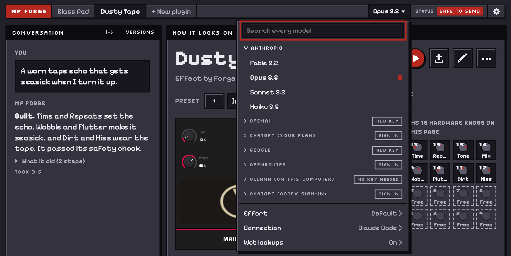
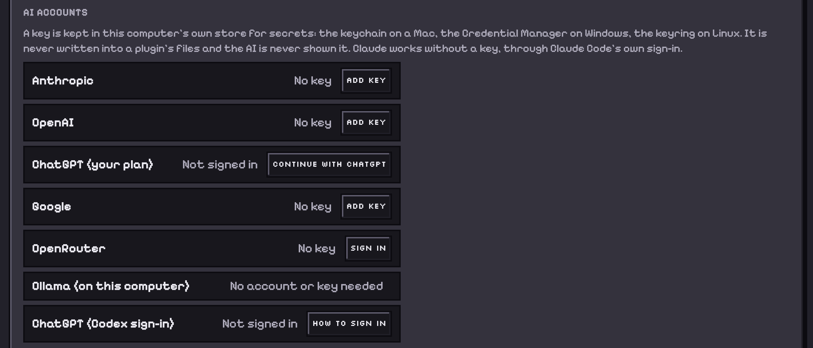

MP Forge does not come with an AI of its own. It uses one of yours: an account you have with an AI service,
or a model that runs on your own computer. MP Forge is free and charges nothing for any of this. What a
service charges, it charges to your own account with it.

## Picking a model

The button in the top bar names the model that builds your plugins. Open it to see every service and the
models each offers. You can search across all of them. Each service's list is asked of the service itself,
so it is always today's list.

Only models that can do MP Forge's work are listed: ones that hold a conversation and can use tools. Not
every model can look at pictures you add.

The first time you pick a model from a service you have not connected, MP Forge asks you to sign in or to
add a key. You can also do that beforehand under **Settings → AI accounts**.

### A model for each plugin

Each plugin keeps the model you picked for it, and the button shows the model of the plugin that is open. So
one plugin can be built by Claude while another is built by a model of another service, and you can give a
plugin a different model at any time: the next change you ask for is made by that one.

A new plugin starts with the model you picked last. So does a plugin that has not been given one yet.
Effort, Connection and Web lookups are the same for every plugin.

## The services

| In the menu | How you connect it |
| --- | --- |
| **Anthropic** (Claude), through **Claude Code** | Install Claude Code from [claude.com/claude-code](https://claude.com/claude-code) and sign in to it. MP Forge needs no key. This is what MP Forge starts on. |
| **Anthropic** (Claude), through the **Claude API** | Paste a key made at console.anthropic.com/settings/keys. |
| **OpenAI** | Paste a key made at platform.openai.com/api-keys. |
| **ChatGPT (your plan)** | Press **CONTINUE WITH CHATGPT** and sign in on OpenAI's own page in your browser. This needs a paid ChatGPT plan, Plus or Pro. |
| **ChatGPT (Codex sign-in)** | Install Codex, OpenAI's own tool, run `codex login` in a terminal, then press **CHECK AGAIN**. |
| **Google** | Paste a key made at aistudio.google.com/apikey. |
| **xAI** | Paste a key made at console.x.ai. |
| **Mistral** | Paste a key made at console.mistral.ai/api-keys. |
| **DeepSeek** | Paste a key made at platform.deepseek.com/api_keys. |
| **OpenRouter** | Press **SIGN IN IN YOUR BROWSER** and approve MP Forge on OpenRouter's page, or press **PASTE A KEY INSTEAD**. |
| **Ollama (on this computer)** | No account and no key. See below. |

For Claude, the menu's **Connection** setting switches between Claude Code and the Claude API.

### Models on your own computer

With Ollama, the model runs on your computer and nothing you make is sent anywhere.

- Ollama has to be running. If it is not, the list says so: open Ollama, then open the list again.
- The model has to be one that can use tools. MP Forge lists only those.
- In Ollama's settings, give models a context length of 64000 or more. With less, they lose track of what
  they were asked.

## The other settings in the menu

Which of these the menu shows depends on the model you picked.

- **Effort** is how hard the model thinks. More is slower and uses more of your allowance.
- **Web lookups** lets the model look things up online while it works. Through OpenRouter each lookup is
  charged, about a cent, on top of what the model costs, so there it starts switched off.

## Where your keys are kept

A key is kept in your computer's own store for secrets: the keychain on a Mac, the Credential Manager on
Windows, the desktop's Secret Service on Linux. It is never written into a plugin's files, and the AI is
never shown it. When you sign in on a service's own page, you never type your password into MP Forge.

If a key for a service is already set in your computer's environment, such as `OPENAI_API_KEY`, MP Forge
uses it when you have not given it one.

**Settings → AI accounts** shows which services are connected, and takes a key away or signs you out again.

## What is sent to the AI

With any service that is not on your own computer, what you type, the plugin's files and any pictures you
add go to that service, under your account. With Ollama, nothing leaves your computer.

**Settings → AI context** sets how much the AI may hold in mind for one request before older material is
dropped to make room. A lower limit costs less. A higher one lets it hold more at once.
