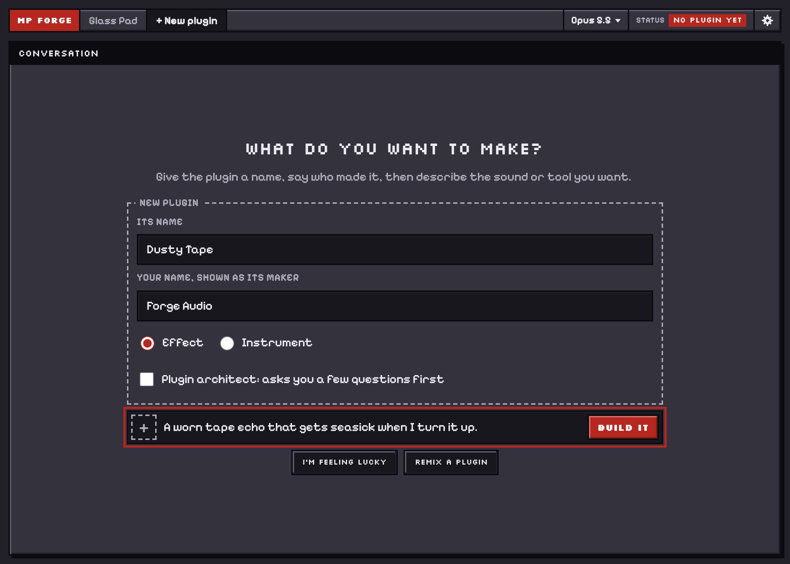
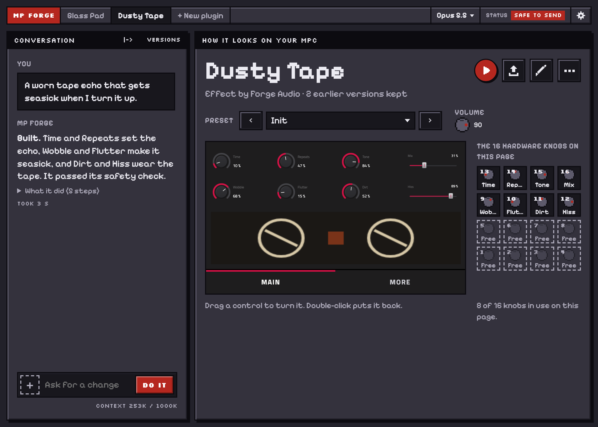
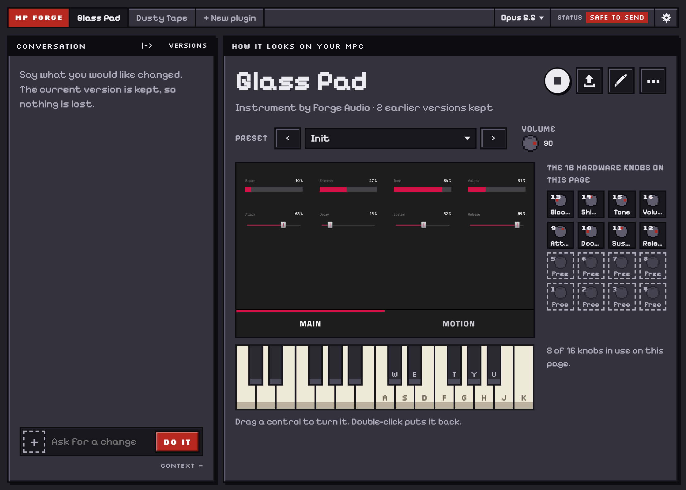
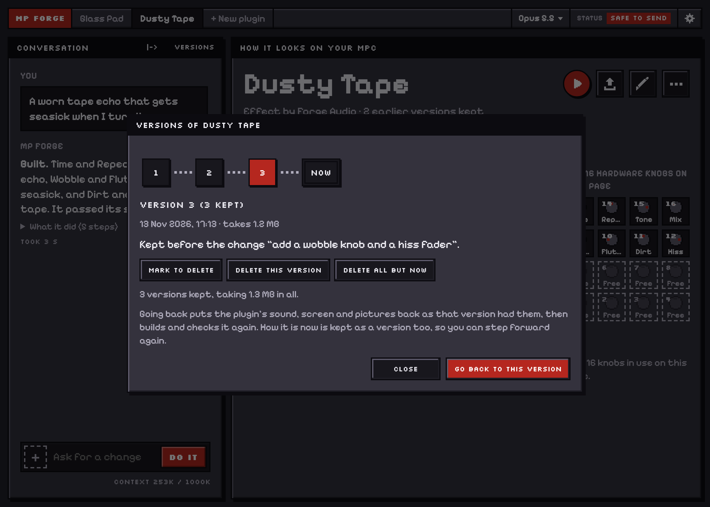
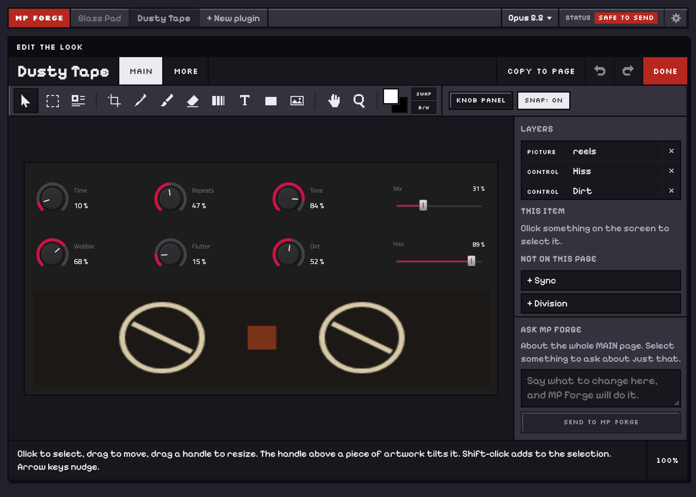

## What MP Forge can build

- An **effect** changes sound that is played through it. It hears no notes.
- An **instrument** makes its own sound when notes are played. A sequencer or arpeggiator has to be an
  instrument that makes its own sound.
- A plugin's screen is a touch screen of pages. Each page holds up to sixteen controls: knobs, faders and
  switches, with pictures and artwork behind them. The MPC's sixteen hardware knobs turn the controls of
  the page that is showing.
- It can play sound files you add, and it comes with a handful of presets.

Some things are out of reach. A plugin cannot send notes to the MPC or control other plugins. It runs on a
small computer inside the MPC, so nothing that needs heavy number work: no long convolution reverbs, no
huge numbers of voices.

## Start a new plugin

Press **+ New plugin** in the top bar.

1. **Its name.** Up to 32 characters. It is shown on the MPC.
2. **Your name, shown as its maker.** Your name or brand. It cannot be changed later.
3. **Effect** or **Instrument**.
4. Describe it in the message box, in plain words.
5. Press **BUILD IT**.

The **+** beside the message box adds things to go with your words:

- A **picture** for the AI to look at: a sketch, a screenshot, a photo of gear. It is not built into the
  plugin.
- A **sound file** for the plugin to play, WAV or MP3: a one-shot, a loop, a wavetable. It travels to the
  MPC with the plugin. One file can be up to 16 MB, and a plugin holds up to 64 files and 64 MB in all.

### If you have no idea yet

- **I'M FEELING LUCKY** rolls the dice for a theme, looks for something new and interesting in it, and
  builds a plugin from what it finds.
- **REMIX A PLUGIN** lets you pick a plugin from the Open MPC catalog, the community's list of open plugins
  for the MPC, and builds your own version of it. MP Forge works from what the original's makers wrote
  about it and how its screen looks. None of its code is copied or installed. Credit the original if you
  share your remix.
- Tick **Plugin architect** to be asked a few questions about your idea first, with choices for each.

## While it is being built

The conversation shows what the AI is doing, step by step. **STATUS** in the top bar says **WORKING**,
**BUILDING** or **CHECKING**. To end the work, press **STOP**.

You need not wait to say what comes next. Type it and press Enter or **QUEUE IT**: it waits under the work
in progress and goes out by itself once that work has ended well. **SEND NOW** on a waiting request stops
the work in hand and sends it at once, and **REMOVE** takes it back. If the work fails or you stop it, what
was waiting stays put until you send it. Requests that are waiting are not kept when MP Forge is closed.

The AI works on up to five plugins at once. While one is being built you can start another, or open one
you made earlier and ask for a change. Each tab shows a mark while its plugin is being worked on.

## See it and hear it

When the plugin is built, its screen shows under **HOW IT LOOKS ON YOUR MPC**, as it will look on the MPC.

- Drag a control to turn it. Double-click puts it back.
- Press a page name along the bottom of the screen to change page.
- **The 16 hardware knobs on this page** says which of the MPC's knobs turns what.

The round **play** button runs the real plugin through your computer's speakers.

- An **instrument** gets a piano to play, with the mouse or from your keyboard: the keys A to K play one
  octave up from middle C, with the black notes on the row above.
- An **effect** is given a beat to work on. **ON** and **OFF** let you compare the sound with and without
  it. You can also choose a WAV or MP3 of your own to play through it. That file stays where it is on your
  computer and is never sent to your MPC.
- **Preset** steps through the presets built into the plugin, and **Volume** sets how loud MP Forge plays.

A plugin that did not pass its safety check is not played.

## Ask for changes

Say what should change in the conversation and press **DO IT**. You can add a picture to show what you
mean.

## Go back a version

A version is kept before every change. **VERSIONS**, at the top of the conversation, lays them out as a
timeline. Step along it and go back to any of them. Going back never throws anything away, so you can step
forward again. The plugin is built and checked again when you go back.

You can delete versions you no longer want from there. **Settings → Versions kept of each plugin** sets a
limit, if you want the oldest thrown away automatically.

## Edit the look by hand

The pencil above the plugin's screen opens **EDIT THE LOOK**. There you can:

- move, resize and restyle the controls on each page,
- add your own artwork,
- copy one page's design to another with **COPY TO PAGE**,
- pick a part of the screen and ask MP Forge to change just that, under **Ask MP Forge**.

Press **DONE** to leave the editor. The last safety check was of the screen as it was before, so it no
longer counts: press **STATUS** and run the check again before you send the plugin.

## Rename or delete it

The three dots above the plugin's screen rename or delete the plugin.

- A renamed plugin is built and checked again. A copy already on your MPC stays there under its old name
  until you remove it.
- A deleted plugin's folder goes to the Trash on your computer. A copy already on your MPC is not touched.

## Where your plugins are kept

Each plugin is a folder of its own on your computer, holding its code, its screen, its versions and your
conversation about it. MP Forge starts with a folder called `MP Forge` in your Music folder.
**Settings → Where your plugins are kept** shows the folder and lets you choose another, for instance one
that gets backed up.

Next: [the safety checks](./safety-checks.md), then [sending it to your MPC](./send-to-your-mpc.md).
