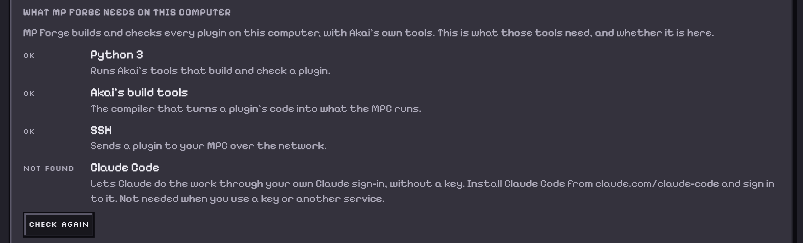
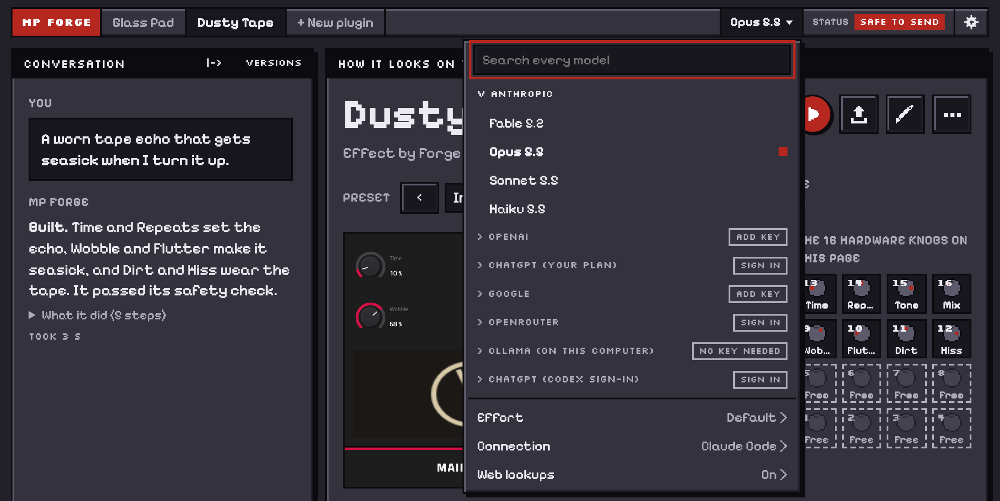
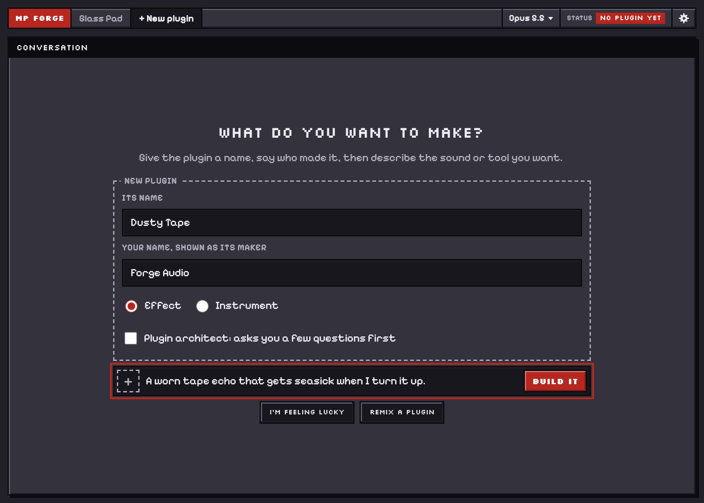
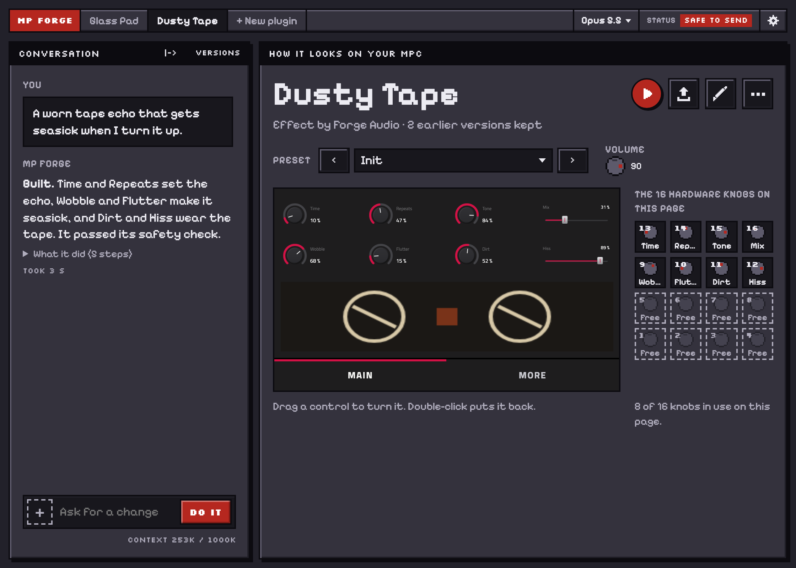
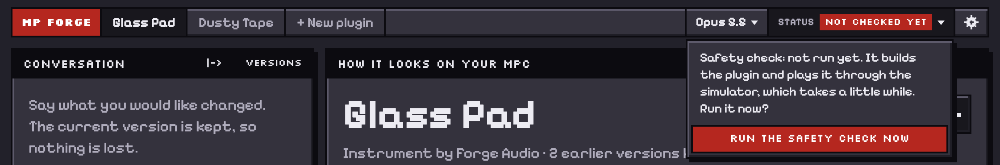
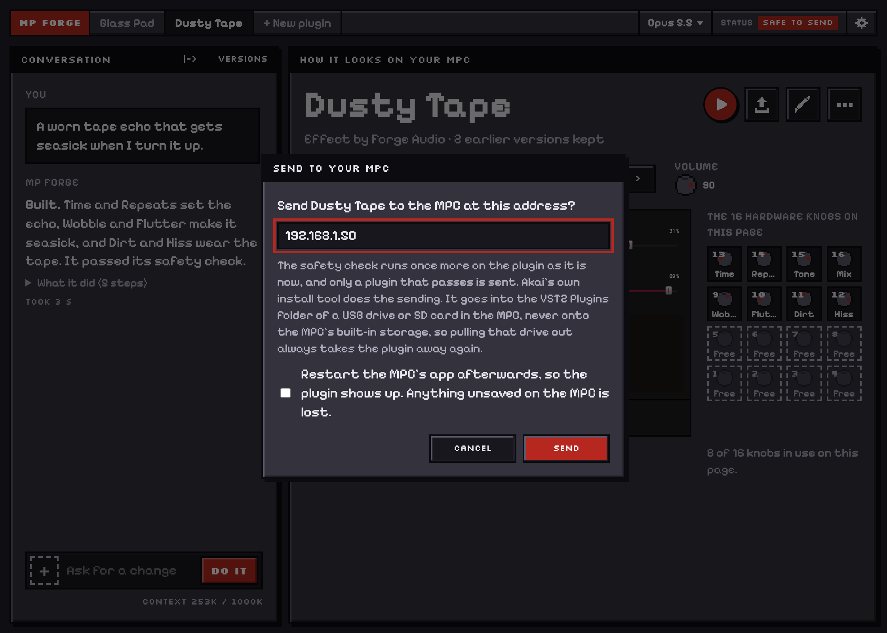

MP Forge makes plugins for Akai MPC standalone hardware from a description. You say what you want, an AI
builds it, MP Forge checks that it is safe, and you send it to your MPC. This page takes you through the
whole first run.

## 1. Download and install MP Forge

1. Open MP Forge's [download page](/mp-forge/download/). The same files are on its
   [releases page on GitHub](https://github.com/Forge-Audio/mp-forge/releases/latest).
2. Download MP Forge for your system: macOS, Windows or Linux.
3. Install it the way you install any app on your system, then open it.

### The first time you open it

MP Forge's installers are not signed yet, so macOS and Windows cannot tell who made it. Each stops it once,
the first time, and you tell it to go ahead. After that it opens like any other app.

**On macOS**

1. Open the `.dmg` and drag MP Forge into Applications.
2. Open MP Forge. macOS says it could not check it and does not open it. Close that message. Do not move
   MP Forge to the Trash.
3. Open **System Settings → Privacy & Security** and scroll down to **Security**.
4. Beside the line about MP Forge, press **Open Anyway**, then type your Mac's password when it asks. The
   button is there for about an hour after step 2.

**On Windows**

1. Run the setup file. Windows may say **Windows protected your PC**.
2. Press **More info**, then **Run anyway**.

**On Linux**

Linux gives no warning. The `.deb` installs like any other package on Debian, Ubuntu and their relatives.
The `.AppImage` runs without being installed, once it is marked as a program: tick that in the file's
Properties, or run `chmod a+x` on it in a terminal.

## 2. Let MP Forge check your computer

The first time it opens, MP Forge offers to show you round. Press **SHOW ME ROUND** for a one-minute tour,
or **SKIP**. You can have the tour again from Settings.

Every time it opens, MP Forge looks for the two things it needs on your computer to build and check a
plugin: Python and Akai's build tools. If either is missing it fetches it for you, there and then. You do
not install anything yourself. The conversation says **Getting this computer ready** while it fetches, and
**This computer is ready** when it has. It is a download of about 80 MB in all, takes a minute or two, needs
the network, and happens once. You can describe your plugin while you wait.

To see what was found, open **Settings** with the cog at the top right, and find **What MP Forge needs on
this computer**. Each thing is marked:

| Mark | What it means |
| --- | --- |
| **OK** | It is here. |
| **MISSING** | No plugin can be made without it. MP Forge could not fetch it, most often because the network was not there. |
| **NOT FOUND** | Optional. Only the one thing it is used for is switched off. |

- If **Python 3** or **Akai's build tools** is still marked MISSING, check the network and press
  **GET WHAT IS MISSING**. MP Forge tries again.
- If something optional is not found, the line beside it says how to get it. Press **CHECK AGAIN** when you
  have.

[What you need](./what-you-need.md) lists everything MP Forge looks for, and what your MPC needs.

## 3. Pick your AI and sign in

MP Forge does not come with an AI. You connect one of your own: an account with an AI service, or Ollama
for models that run on your own computer with no account.

The button in the top bar names the AI model that builds your plugins. Open it to pick another. The first
time you pick a model from a service you have not used, MP Forge asks you to sign in or to add a key.

MP Forge starts on a Claude model, reached through Claude Code. That works with no key if you have Claude
Code installed and signed in. If you do not, pick a model from any other service in the menu.

[Choosing an AI](./choosing-an-ai.md) lists every service and how each one is connected.

## 4. Make your first plugin

Press **+ New plugin** if the form is not already showing.

1. Give the plugin **its name**, and **your name** as its maker. Both are shown on the MPC. The maker's
   name cannot be changed later.
2. Choose its kind. An **effect** changes sound played through it. An **instrument** makes sound when you
   play notes.
3. Say what you want, as you would to a friend: "a worn tape echo that gets seasick when I turn it up".
4. Press **BUILD IT**.

The AI writes the plugin, and MP Forge builds it and runs its safety check. This takes a while. The
conversation shows each step as it happens, and **STOP** ends the work.

When it is done, the plugin's screen appears under **HOW IT LOOKS ON YOUR MPC**. Press the round play button
to hear the real plugin through your computer's speakers. To change something, say what in the
conversation and press **DO IT**.

[Making your first plugin](./first-plugin.md) covers playing it, changing it, going back a version and
editing its look by hand.

## 5. Check that it is safe

**STATUS** in the top bar says where the plugin stands. **SAFE TO SEND** means it passed every check.
**BLOCKED** means one check failed. Ask for a fix in the conversation.

If it says **NOT CHECKED YET**, press it and choose **Run the safety check now**.

[The safety checks](./safety-checks.md) says what is checked, and what the checks cannot promise.

## 6. Send it to your MPC

Set your MPC up once:

1. It has to run **MPC OS 3.10.1 or later**. Check under Preferences → Info and update it if it is older.
2. Under **Preferences → Enhancements (Beta)**, switch on **Enable Enhancements** and **External Plugin
   Support**.
3. Switch on the MPC's developer mode, so that it can be reached over the network.
4. Put a USB drive or an SD card in the MPC. MP Forge never writes to the MPC's built-in storage.

Then, in MP Forge, press the **Send to your MPC** button above the plugin's screen, type in your MPC's
address, and press **SEND**. The MPC shows its address under its Wi-Fi settings.

On the MPC, the plugin is listed under **External Plugins** in the plugin browser once the MPC's app has
been restarted.

[Sending a plugin to your MPC](./send-to-your-mpc.md) has every step, developer mode included.

## If something goes wrong

[Troubleshooting](./troubleshooting.md) lists the messages MP Forge shows and what to do about each. If you
are still stuck, ask in the [Forge Audio Discord](https://discord.gg/EWkFTAEgJr).
