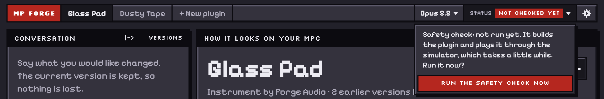
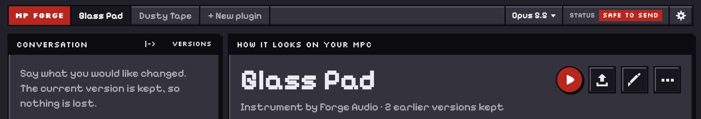

A plugin runs inside the MPC's own app, and the MPC has no protection against a plugin that misbehaves.
Akai's SDK puts it plainly: a bug can freeze or restart the MPC. So MP Forge builds every plugin and plays
it through a simulator on your computer first. Nothing is sent to your MPC without passing.

## What you see

**STATUS** in the top bar says where the open plugin stands:

| Status | What it means |
| --- | --- |
| **NOT CHECKED YET** | No check has been run on the plugin as it is now. Press it and choose **Run the safety check now**. |
| **CHECKING** | The check is running. It builds the plugin and plays it through the simulator, which takes a little while. |
| **SAFE TO SEND** | It passed every check. |
| **BLOCKED** | One check failed. The plugin cannot be sent and is not played. |

When a plugin is blocked, the conversation says which check blocked it and why. Ask for a fix there.

## When the check runs

- After the AI finishes building or changing a plugin. If the plugin does not pass, it is handed back to
  the AI to repair, and the check runs again.
- When you press **STATUS** and choose **Run the safety check now**.
- After you rename a plugin or go back to an earlier version.
- Once more on the plugin as it is, every time you press **SEND**.

Whatever the AI says about its own work, the verdict is MP Forge's.

## The twelve checks

They run in this order and stop at the first one that blocks.

| Check | What it does |
| --- | --- |
| **Code stays inside the plugin** | Reads the plugin's code for things no plugin should do: starting other programs, using the network, starting its own threads, writing or deleting files, loading other code, stopping the MPC's app or pausing its audio. This comes first, before any of the plugin's code is run on your computer. The one way round is experimental and off until you switch it on: [a plugin that goes online](./online-plugins.md) through MP Forge's own helper. |
| **Pictures can be drawn** | Every picture on the plugin's screen can be drawn. |
| **Builds for every MPC** | Akai's tools build the plugin for both kinds of chip MPCs use, and for your computer, then Akai's validator checks the result. |
| **Screen loads with its pictures** | The finished screen, with its pictures and anything you arranged by hand, passes Akai's validator. |
| **Moving pictures move** | A picture that is meant to move by itself really does. |
| **Survives everyday use** | The plugin is played through Akai's simulator. |
| **Survives a full chord** | An instrument is played eight notes at once. |
| **Survives a playing song** | The same, with the song running. |
| **Survives the smallest buffer** | Sound is asked for in the smallest pieces. |
| **Survives the largest buffer** | Sound is asked for in the largest pieces. |
| **Survives a 48 kHz project** | The project runs at 48 kHz. |
| **Survives a long session** | It is played for thirty seconds. |

In the simulator, a plugin is blocked when it crashes, freezes, puts out sound that is not a number, or
does not come back the same after its settings are saved and loaded. Clipping, silence and heavy use of the
processor are warnings: the plugin still passes, and the warning is kept with the result.

## What the checks cannot promise

- **Reading the code is a tripwire, not a wall.** It stops the obvious cases. Code that sets out to hide
  from it could.
- **The simulator is not your MPC.** The MPC's processor is much slower than a computer's. A plugin that
  passes can still be too heavy when several copies of it run at once.
- **Passing says the plugin is safe to try, not that it sounds right.** That part is yours.

## If a plugin does misbehave on the MPC

MP Forge only ever sends a plugin to a USB drive or SD card, never to the MPC's built-in storage. Pulling
that drive out takes the plugin away again. Save your work on the MPC before you try a new plugin.
