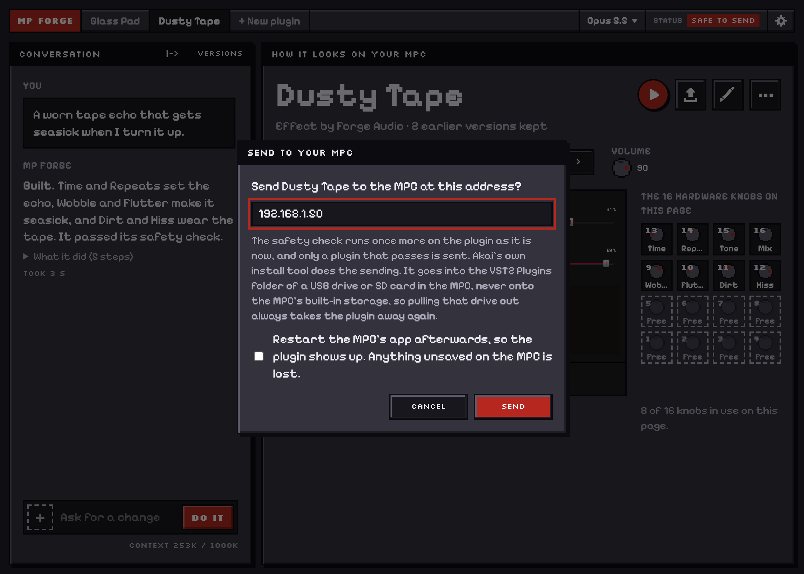
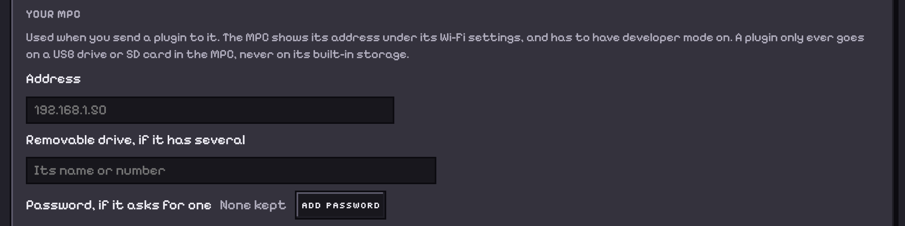

MP Forge sends a plugin over your network with Akai's own install tool, which is part of Akai's SDK. The
plugin goes into the `VST2 Plugins` folder of a USB drive or SD card in the MPC. It never goes onto the
MPC's built-in storage, so pulling that drive out always takes the plugin away again.

> **Not tried everywhere yet.** Sending has been tried by hand from a Mac and from Windows. Sending from
> Linux has not yet been tried by hand.

## Set your MPC up once

The steps on the MPC itself are Akai's, as its SDK gives them.

1. **Update the MPC to MPC OS 3.10.1 or later.** Preferences → Info shows the version. Older versions
   cannot load third-party plugins.
2. **Switch on external plugins.** Under Preferences → Enhancements (Beta), switch on **Enable
   Enhancements** and **External Plugin Support**, and read the warning the MPC shows. Plugins stay hidden
   until both are on.
3. **Switch on developer mode.** This lets the MPC be reached over the network. Under Preferences → Info,
   tap the version value three times, the serial number value twice, and the firmware version once.
4. **Put a USB drive or an SD card in the MPC.**
5. **Put the MPC on the same network as your computer**, and note its address. The MPC shows it under its
   Wi-Fi settings. It looks like `192.168.1.50`.

Switch developer mode off again when you are done, if you are on a network you do not control.

## What your computer needs

SSH, which is what carries the plugin across. Settings lists it under **What MP Forge needs on this
computer**. It comes with macOS. On Windows, add "OpenSSH Client" under Windows Settings, Optional
features. On Linux, install `openssh-client`.

## Send it

1. Open the plugin. Its status has to say **SAFE TO SEND**. If it does not, see
   [the safety checks](./safety-checks.md).
2. Press the **Send to your MPC** button above the plugin's screen.
3. Type in your MPC's address. MP Forge remembers it for next time.
4. Tick **Restart the MPC's app afterwards** if you want the plugin to show up straight away. Anything
   unsaved on the MPC is lost when its app restarts, so save there first. The box is never ticked for you.
5. Press **SEND**.

The safety check runs once more on the plugin as it is now. Only a plugin that passes is sent. The
conversation then says which drive it went onto.

## Find it on the MPC

The plugin shows in the MPC's plugin list once the MPC's app has been restarted. It is listed under
**External Plugins** in the plugin browser. An instrument is used as a plugin program. An effect is used as
an insert.

## Settings for your MPC

**Settings → Your MPC** holds three things:

- **Address.** Where your MPC is on the network.
- **Removable drive, if it has several.** When the MPC has more than one USB drive or SD card in it, say
  which to use, by its name or its number. With only one, leave this empty.
- **Password, if it asks for one.** Only needed when your MPC asks for one. It is kept in your computer's
  own store for secrets and handed to Akai's install tool when a plugin is sent.

## Sending a newer version

Send it again. The plugin goes onto the drive in place of the copy already there.

A plugin you renamed is a different matter. The copy on your MPC stays there under its old name until you
remove it.

## Taking a plugin off the MPC

MP Forge does not remove plugins from an MPC. Pull the drive out, or delete the plugin's folder from the
drive's `VST2 Plugins` folder. Projects that used the plugin load without it.

## Without the network

Akai's SDK also describes copying a plugin by hand: the built plugin is a folder named
`<Maker> - VST - <Name>`, and it goes into a folder named exactly `VST2 Plugins` at the root of a USB drive
or SD card. MP Forge builds that folder inside the plugin's own folder on your computer, under `build`.
MP Forge has no button for this yet. If you copy it by hand, do it only when the plugin's status says
**SAFE TO SEND**.
