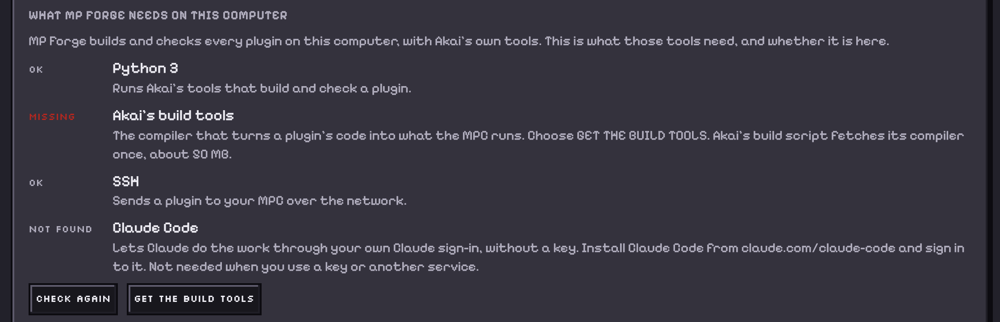

## On your computer

MP Forge is made for macOS, Windows and Linux. [What is and is not finished](./status.md) says how far
each of them has been tested.

MP Forge looks for what it needs every time it opens, and tells you if something is missing and how to get
it. You can see the list at any time under **Settings → What MP Forge needs on this computer**.

### To build and check plugins

MP Forge cannot make a plugin without these two. Settings marks each as **OK** or **MISSING**.

| What | What it is for | How to get it |
| --- | --- | --- |
| **Python 3** | Runs Akai's tools that build and check a plugin. Akai's SDK asks for Python 3.9 or newer. | See below. |
| **Akai's build tools** | The compiler that turns a plugin's code into what the MPC runs. | Press **GET THE BUILD TOOLS** in Settings. MP Forge fetches it once, about 50 MB. |

If Settings marks Python 3 as missing, this is where to get it:

- **macOS:** install it from [python.org](https://www.python.org).
- **Windows:** install it from the Microsoft Store, or from python.org with "Add python.exe to PATH" ticked.
- **Linux:** install `python3` and `python3-venv` with your system's package manager.

Then press **CHECK AGAIN**.

### Optional

Each of these only switches on the one thing it is used for. Settings marks one that is absent as
**NOT FOUND**.

| What | What it is for | How to get it |
| --- | --- | --- |
| **SSH** | Sends a plugin to your MPC over the network. | It comes with macOS. On Windows, add "OpenSSH Client" under Windows Settings, Optional features. On Linux, install `openssh-client`. |
| **Claude Code** | Lets Claude do the work through your own Claude sign-in, without a key. | Install it from [claude.com/claude-code](https://claude.com/claude-code) and sign in to it. Not needed when you use a key or another service. |

### On Linux

- Keys and sign-ins are kept in the desktop's Secret Service, so one has to be running. GNOME Keyring is
  one.
- Pasting into MP Forge uses `wl-paste`, `xclip` or `xsel`, whichever is installed.

### An AI

MP Forge does not come with an AI. You connect one of your own: an account with an AI service, or Ollama for
models that run on your computer with no account. [Choosing an AI](./choosing-an-ai.md) lists them all.

## On your MPC

Plugins made with MP Forge run on Akai MPC standalone hardware. This is what Akai's SDK says an MPC needs:

- **MPC OS 3.10.1 or later.** Older versions cannot load third-party plugins at all.
- **External Plugin Support switched on.** Under Preferences → Enhancements (Beta), switch on both
  **Enable Enhancements** and **External Plugin Support**.
- **A USB drive or an SD card**, for the plugin to live on.

To have MP Forge send a plugin over the network, the MPC also needs its developer mode on, and has to be on
the same network as your computer. [Sending a plugin to your MPC](./send-to-your-mpc.md) has the steps.

Akai's SDK lists these as the MPCs its plugins run on: MPC X, X SE, Live, Live II, One, One+, Key 61,
Key 37 and Force, and MPC Live III, MPC XL and later. MP Forge builds every plugin for both kinds of chip
those use. MPC Studio and other controllers that run on a computer are not among them.
